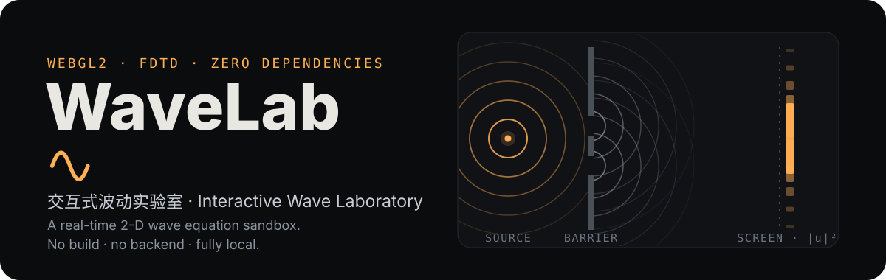

<div align="center">

[简体中文](README.md) · **English**



[](https://github.com/LINYEANSHU/wave-simulator/actions/workflows/ci.yml)
[](LICENSE)

**See the wave equation in action: draw sources, draw obstacles, and let the physics do the rest.**

WaveLab is a real-time two-dimensional wave simulator that runs entirely in your browser. It numerically solves the 2-D wave equation with FDTD (the finite-difference time-domain method), so you can watch propagation, superposition, interference, diffraction, the Doppler effect, and beats as they actually unfold — then measure them with a probe and an observation screen. All computation happens on your local GPU (a WebGL2 fragment shader): no backend, no dependencies, nothing uploaded.

</div>

---

## Quick start

Serve the folder with any static file server:

```bash
# Python
python -m http.server 8080
# then open http://localhost:8080 in your browser

# or Node
npx serve .
```

You can also simply double-click `index.html` — the page uses no ES modules and no external resources, so it runs from `file://` as well.

**Browser requirements**: an up-to-date Chrome, Edge, or Firefox with WebGL2 and the `EXT_color_buffer_float` extension (the page shows a clear message if either is missing).

## Twelve teaching scenes

Each scene is a classic physics demonstration you can measure quantitatively — or take apart and rebuild.

| Scene | What happens | Teaching value · what to watch |
| --- | --- | --- |
| Double-Slit Interference | Plane waves pass through two slits; fringes form on the screen | Switch to the intensity view + screen, read the fringe spacing, compare with λL/d |
| Single-Slit Diffraction | A plane wave spreads after a narrow slit | Watch the central maximum widen as the slit narrows (resize it with the eraser) |
| Huygens' Principle | Plane waves cross a multi-slit array; every slit re-radiates | Directional beams from a 5-slit grating; positions of the principal maxima |
| Standing Wave | Two identical plane waves travelling opposite directions | Nodes and antinodes stay put; a probe on a node barely responds |
| Lloyd's Mirror | Direct and mirror-reflected waves from one point source interfere | Dark fringes hugging the mirror (the reflection phase shift made visible) |
| Parabolic Focusing | A plane wave reflects off a parabola into its focus | The probe sits at the focus — compare amplitude inside vs. outside |
| Multi-Source Interference | Five evenly spaced in-phase sources form a beam | Add or remove sources and watch the main lobe sharpen |
| Doppler Effect | A source moves back and forth | Wavefronts bunch up ahead, stretch out behind; set playback to ¼× |
| Beat Interference | Two close frequencies add up | Place the probe midway between the sources and read the beat frequency Δf |
| Dipole Radiation | Two out-of-phase sources | Reinforced along the axis, cancelled on the bisector — flip one phase to 0° and watch the pattern invert |
| Cavity Standing Wave | Circular waves and their reflections inside rigid walls | Boundary modes (bright corners, strong antinodes) |
| Sandbox | A blank field with free placement | Build your own experiment with reflective or absorbing walls |

## How to use

- **Toolbar on the left** (keys `1`–`5`): **Source** (click to place, drag to move) · **Pulse** (click to launch a ripple) · **Wall** (drag to draw; switch material in the panel) · **Eraser** (drag to clear; right-click drag works with any tool) · **Probe** (click to drop one; a panel shows the live waveform and measured frequency).
- **Panel on the right**: source cards (frequency / amplitude / phase / mute / delete); view mode (wave field / time-averaged intensity), three palettes, boundary type, screen toggle and position; wave speed, playback speed, gain, brush size, wall material; pause / step / reset / clear. Every control has a tooltip.
- **Keyboard**: `Space` pause/resume · `S` single step (pauses first, then advances 1/60 s of simulation time) · `R` reset the field · `1`–`5` switch tools.
- The readout strip shows the grid size, wavelength λ, wave speed v, Courant number, and frame rate; the camera icon in the header exports a PNG (measurements included).
- The UI speaks **English and Chinese**: click the 🌐 button in the header, or let the browser language decide on first visit.

## Physics & numerics in brief

The in-app "How it works" dialog has the full story; the essentials:

- **Equation and scheme**: the 2-D scalar wave equation ∂²u/∂t² = c²∇²u, advanced with explicit second-order central differences (FDTD). Stability requires C = c·Δt/Δx ≤ 1/√2; the UI keeps C between 0.08 and 0.70. The time step is fixed at Δt = 1/180, decoupled from the display frame rate — a low frame rate only slows playback, it never changes the waveform.
- **Sources**: soft sources (an additive source term, nearly transparent to outgoing waves); point sources use a Gaussian window, plane waves a vertical Gaussian strip; the initial phase is adjustable, and uniformly moving sources are supported.
- **Obstacles and boundaries**: reflective walls force u = 0 (perfect reflection); absorbing walls apply strong velocity damping (an approximate reflection-free material); the outer boundary is either a cubic-ramp sponge layer (a crude PML) or a rigid wall.
- **Screen sampling**: the screen reads one column of time-averaged intensity |u|² (an exponential moving average, τ ≈ 1.4 s of simulation time) and draws the profile beside it — the numerical counterpart of the intensity pattern on a double-slit bench.
- **Single-step mode**: while paused, `S` advances 3 time steps (1/60 s of simulation time), so you can watch interference and diffraction build up frame by frame with the probe oscilloscope.
- **Known approximations**: numerical dispersion (keep λ ≥ 10 cells), 2-D point sources decay as ~1/√r, absorbing walls still reflect partially at grazing incidence, and real surface gravity waves are nonlinear — those effects are not modelled.

## Project structure

```
wave-simulator/
├── index.html        page skeleton, controls, "how it works" dialog
├── css/style.css     the "darkroom" visual system (matte black / silver / safelight amber)
└── js/
    ├── i18n.js       English–Chinese dictionary and language switching
    ├── glutil.js     WebGL helpers (shader cache, program wrapper, fullscreen triangle)
    ├── sim.js        simulation core: stepping/render shaders, WaveSim class, measurement readback
    ├── scenes.js     definitions of the twelve teaching scenes
    ├── ui.js         tool state machine, pointer interaction, cards, HUD
    └── main.js       boot, fixed-timestep main loop (rAF + starvation watchdog), resizing
```

## Implementation notes

- **Rendering**: the canvas back buffer *is* the simulation grid, displayed with CSS smoothing — this sidesteps float-texture linear-filtering compatibility issues.
- **Data layout**: one RGBA float texture double-buffered as `(u, u_prev, time-avg intensity)`; the obstacle mask is RGBA8 (R = reflective, G = absorbing), uploaded on change.
- **Measurement readback**: 1×1 (probe) and 1×H (screen) `readPixels` calls every frame or every other frame — negligible overhead.
- **Main loop**: requestAnimationFrame with a starvation watchdog (if the environment suspends rAF while the page is visible, a 16 ms timer takes over); `?autodrive` is a hook for automated testing.
- **Performance**: 140+ FPS on desktop (1× playback, 144 Hz display).

## References & acknowledgements

- The twelve scenes draw their inspiration from **undergraduate wave-optics demonstrations** — double-slit interference, single-slit diffraction, Huygens' principle, Lloyd's mirror, and standing waves are all classic lecture demonstrations. This project turns their water-tank cousins into a hands-on sandbox.
- The numerics follow the **finite-difference time-domain (FDTD)** idea introduced by Kane Yee in 1966 (the same grid-based difference scheme used for Maxwell's equations, here applied to the scalar wave equation).
- The stack is **vanilla WebGL2 + vanilla JavaScript**: no runtime dependencies, no build system, and a hand-written English–Chinese dictionary for the UI.

## License

[MIT](LICENSE) © 2026 LINYEANSHU — free to use, modify, and distribute.
