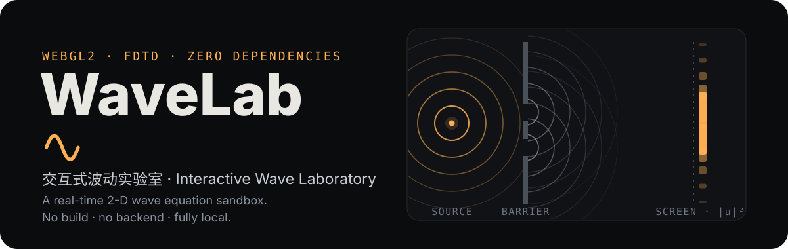
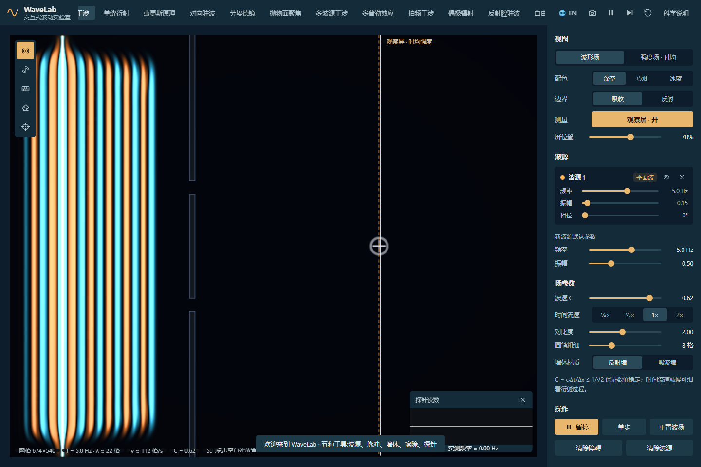
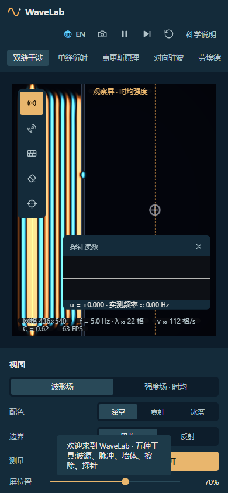

<p align="center">简体中文 · <a href="README.en.md">English</a></p>

<p align="center">
  
</p>

**画波源、画障碍，在浏览器里观察传播、干涉与衍射。**
WaveLab 用 WebGL2 实时推进二维标量波动方程，并用探针和观察屏测量波形与时均强度。



<details>
<summary>查看移动端界面</summary>



</details>

[](https://github.com/LINYEANSHU/wave-simulator/actions/workflows/ci.yml)
[MIT](LICENSE) · 原生 JavaScript / WebGL2 · 无构建 · 中文 / English

## 先做一次双缝实验

直接打开 `index.html`，页面会加载双缝场景。也可以用 Python 3 启动本地服务器：

```bash
git clone https://github.com/LINYEANSHU/wave-simulator.git
cd wave-simulator
python -m http.server 8080 --bind 127.0.0.1
```

打开 **http://127.0.0.1:8080**。脚本和资源均在仓库内，运行时无需联网或安装依赖。

浏览器需支持 **WebGL2** 与 **`EXT_color_buffer_float`**；初始化失败时页面会显示错误。可使用支持这些能力的现代 Chrome、Edge 或 Firefox。

1. 等待波前穿过双缝，再到达虚线观察屏。
2. 切换到「强度场 · 时均」，观察逐渐形成的条纹。
3. 改变源频率或用擦除工具改变缝宽，比较衍射和干涉图样。
4. 放置探针读取局部波形；暂停后单步查看变化，或用相机按钮导出 PNG。

## 十二个可编辑场景

预设会放置波源、障碍和测量工具；加载后仍可以继续修改。

| 场景 | 观察重点 |
| --- | --- |
| 双缝干涉 | 观察屏的时均条纹 |
| 单缝衍射 | 缝宽与波的横向展开 |
| 惠更斯原理 | 多缝形成的定向波束 |
| 对向驻波 | 固定的波节与波腹 |
| 劳埃德镜 | 直射波与反射波的干涉 |
| 抛物面聚焦 | 焦点内外的振幅差别 |
| 多波源干涉 | 等距同相源的主瓣 |
| 多普勒效应 | 运动源前后波前间距 |
| 拍频干涉 | 相近频率叠加后的包络 |
| 偶极辐射 | 反相源的方向性 |
| 反射腔驻波 | 腔体内的驻波模式 |
| 自由实验 | 自选波源、反射墙和吸波墙 |

## 工具与测量

| 操作 | 方式 |
| --- | --- |
| 放置 / 移动波源 | `1`，点击放置，拖动已有波源 |
| 激发脉冲 / 画墙 / 擦除 / 放探针 | `2` / `3` / `4` / `5` |
| 临时擦除 | 任意工具下右键拖动 |
| 暂停 / 单步 / 重置波场 | `Space` / `S` / `R` |
| 调整频率、振幅、相位 | 波源卡片 |
| 强度场、配色、边界、观察屏 | 视图区域 |
| 波速、时间流速、画笔和墙材质 | 参数面板 |
| 导出 / 切换语言 | 顶栏相机 / 语言按钮 |

探针显示位移随时间的变化与实测频率。观察屏显示沿竖线采样的指数平均强度 `⟨u²⟩`，需要等待波到达并积累采样；它不是即时的远场解析解。

## 数值模型

求解 `∂²u/∂t² = c²∇²u`，采用显式二阶中心差分，时间步长 `Δt = 1/180`。Courant 数 `C = cΔt/Δx` 在界面中限制为 0.08–0.70，低于二维格式的稳定上限 `1/√2`。

波场保存在双缓冲浮点纹理中，由 fragment shader 推进。反射墙施加 `u = 0`，吸波墙加入阻尼；外边界可切换海绵吸收层或反射边界。物理使用固定步长，低帧率时会丢弃积压时间以限制计算量。

完整说明可在页面「科学说明」中查看。建议每个波长至少跨越约 10 个网格，以减轻数值色散；吸收层仍可能产生残余反射。模型是线性二维标量波，不包含真实水面波的完整流体动力学。

## 源码与检查

| 文件 | 职责 |
| --- | --- |
| [sim.js](js/sim.js) / [glutil.js](js/glutil.js) | FDTD、WebGL2 渲染与测量回读 |
| [scenes.js](js/scenes.js) | 十二个教学场景 |
| [ui.js](js/ui.js) / [i18n.js](js/i18n.js) | 工具、测量浮板与双语文案 |
| [main.js](js/main.js) | 固定步长循环与画布尺寸 |

CI 使用 Node.js 22 执行全部 JavaScript 语法检查。PowerShell：

```powershell
Get-ChildItem js -Recurse -Filter *.js | ForEach-Object { node --check $_.FullName; if ($LASTEXITCODE) { throw $_.FullName } }
```

语法检查不覆盖着色器编译、数值精度或设备性能；调整数值模型后应在浏览器中复查波传播和测量结果。

## 贡献者

- [LINYEANSHU](https://github.com/LINYEANSHU)

## 许可证

[MIT](LICENSE) © 2026 LINYEANSHU。项目使用浏览器原生 API，无第三方运行时库。教学场景围绕经典波动光学实验设计。
